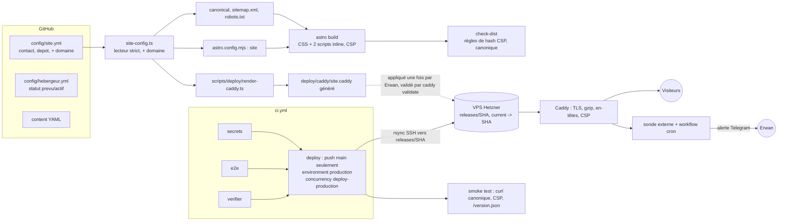

# Architecture : intégration du Lot 3 (hébergement et mise en ligne)

**Milestone :** v1.1, échéance spec 2026-12-15
**Researched :** 2026-11-06
**Portée :** uniquement ce que les nouvelles fonctions ajoutent ou changent dans l'architecture existante (docs/ARCHITECTURE.md ADR-001..052, docs/RUNBOOK.md, ci.yml).
**Confiance globale :** MEDIUM-HIGH. Le code du dépôt a été lu (HIGH). Le comportement exact de `security.csp` d'Astro 7 avec des scripts `is:inline` n'a pas été vérifié par exécution (MEDIUM, voir « Spike CSP »). Les réglages Caddy/GitHub Environments viennent de la connaissance générale, pas d'une relecture de la documentation (MEDIUM).

## Constats sur l'existant qui contraignent la conception

| Constat (fichier) | Conséquence |
|---|---|
| `astro.config.mjs` n'a **pas de `site`** ; `Base.astro` n'émet ni `canonical` ni Open Graph ; `src/pages/robots.txt.ts` ne contient pas de ligne `Sitemap:` ; aucun sitemap | Canonique, sitemap et robots sont **tous à créer**. Pas de dette à migrer. |
| `config/site.yml` n'a que `contact` et `depot` ; `site-config.ts` rejette toute clé inconnue (`CLES`) et porte déjà la garde `.invalid` + `RTP_DEPLOIEMENT=1` | Le domaine s'ajoute **au même fichier et au même lecteur strict**, avec la même garde « provisoire ». |
| `Base.astro` charge `ordre.js` en `<script is:inline src>` ; `LecteurNiveaux.astro` charge `niveau.js` de même ; CSS externe (`inlineStylesheets: 'never'`, `assetsInlineLimit: 0`) | `dist-reel/_astro/` = 3 CSS + 2 JS. HTML puis CSS = 2 allers-retours en série, cause du dépassement Slow 4G (PROJECT.md). |
| `tests/dist/cas/ordre.cas.ts:78-84` et `niveaux.cas.ts:83-98` exigent le fichier du dist **octet pour octet identique** à `src/scripts/*.js` et <= 2048 octets. `check-dist` (`SCRIPT_EN_LIGNE`, `STYLE_EN_LIGNE`) interdit tout `<script>` sans `src`, tout `on*`, tout `<style>`, tout `style=` | Inliner **casse ces règles par construction**. Elles doivent être remplacées par des règles de hash, pas supprimées. |
| `tests/repo/ci.test.ts` vérifie notamment que `RTP_MODE` n'est jamais fixé dans la CI | Le job de déploiement ne fixe que `RTP_DEPLOIEMENT=1`, jamais `RTP_MODE`. Le test doit être étendu, pas contourné. |
| `ids.lock` en ajout seul, contrôlé en CI contre le commit de base | **`git revert` d'un commit de contenu qui ajoute des ids échoue en CI** (les ids disparaîtraient). Le rollback ne peut pas reposer sur un revert de contenu. |
| ADR-041 : en production, le statut qui fait foi = dernier statut `relu`/`publie` ; l'import ajoute des statuts en `brouillon` | Un import de décembre **ne change pas** la production tant qu'Erwan n'a pas relu : c'est ce qui rend l'import sûr à fusionner tard. Exception : les comptes dérivés de l'instantané (ADR-050, voir W3). |
| `check-dist` accepte déjà un `--dist` construit plus tôt et signale `CONTACT_PROVISOIRE` / `HEBERGEUR_PREVU` en erreur sous `RTP_DEPLOIEMENT=1` | La garde est déjà conçue pour s'exécuter sur un dist, pas seulement pendant le build. |

## Architecture cible



## Composants : nouveaux et modifiés

| Composant | Statut | Rôle / changement |
|---|---|---|
| `config/site.yml` | **Modifié** | Ajoute `domaine` (nom d'hôte seul, ex. `exemple.fr`). Valeur provisoire `domaine-a-definir.invalid` tant que non acheté, même mécanisme que `contact`. |
| `src/lib/site-config.ts` | **Modifié** | Ajoute `domaine` à `CLES`, validation (hôte DNS, pas d'URL, pas de schéma), `domaineProvisoire`, URL canonique dérivée `https://<domaine>`. Garde `RTP_DEPLOIEMENT=1` : erreur si domaine provisoire (même branche que `contactProvisoire`). Exporte aussi `urlSite`. |
| `astro.config.mjs` | **Modifié** | `site: urlSite` lu depuis `site-config` (une seule lecture). Régler `inlineStylesheets: 'always'`, `assetsInlineLimit` à reconsidérer, et, si le spike CSP le valide, `security.csp`. |
| `src/layouts/Base.astro` | **Modifié** | `<link rel="canonical" href={new URL(Astro.url.pathname, Astro.site)}>` ; en preview, pas de canonique (cohérent avec `noindex`). Script `ordre` inline. |
| `src/components/LecteurNiveaux.astro` | **Modifié** | Script `niveau` inline juste après `</fieldset>` (reste bloquant, c'est l'objet de l'ADR-040 : pas de flash de niveau). |
| `src/pages/robots.txt.ts` | **Modifié** | Production : `Allow: /` + `Sitemap: https://<domaine>/sitemap.xml`. Preview : inchangé (`Disallow: /`, pas de Sitemap). |
| `src/pages/sitemap.xml.ts` | **Nouveau** | Endpoint écrit à la main (comme `robots.txt.ts`), liste les pages construites ; vide de brouillons en production par construction (même `getCorpus`). Évite la dépendance `@astrojs/sitemap` (règle « chaque dépendance justifiée »). En preview : aucune route (ou 404 construit). |
| `src/pages/version.json.ts` (ou `release.txt`) | **Nouveau** | SHA du commit + date de build (variable d'env `GITHUB_SHA`, repli `dev`). Sert au smoke test et à repérer la release active. Aucune donnée personnelle. |
| `scripts/lib/check-dist.ts` | **Modifié** | Remplace `SCRIPT_EN_LIGNE`/`STYLE_EN_LIGNE` par : (a) interdire toujours `on*`, `style=`, `javascript:`, `data:` ; (b) pour chaque `<script>`/`<style>` en ligne, exiger que son hash sha256 figure dans la CSP de la page (meta) ou dans la liste globale ; (c) `CANONIQUE_ABSENT/INCORRECT` en production (doit valoir `https://<domaine>` + chemin) ; (d) `SITEMAP_*` ; (e) en production sous `RTP_DEPLOIEMENT=1`, au moins un thème publié (`SITE_VIDE`). Limites de poids : le budget 100 Ko gzip compte désormais le HTML seul (CSS/JS déjà dedans). |
| `tests/dist/cas/ordre.cas.ts`, `niveaux.cas.ts` | **Modifiés** | Remplacer « fichier du dist identique à la source » par « contenu du `<script>` en ligne égal à `src/scripts/*.js` (après `trim`) ET son hash est dans la CSP ». Le garde-fou de fond (le code servi = le code relu) est conservé. |
| `tests/repo/ci.test.ts` | **Modifié** | Vérifie : job `deploy` a `needs: [verifier, e2e, secrets]`, condition `push` + `refs/heads/main`, `environment: production`, `concurrency.cancel-in-progress: false`, actions épinglées par SHA, `RTP_MODE` absent, `RTP_DEPLOIEMENT=1` présent seulement dans `deploy`. |
| `.github/workflows/ci.yml` | **Modifié** | Nouveau job `deploy` (voir ci-dessous). Le job `verifier` n'est **pas** touché (il doit continuer à passer avec `statut: prevu`). |
| `.github/workflows/rollback.yml` | **Nouveau** | `workflow_dispatch` avec l'entrée `release` (SHA ou `previous`) ; bascule le lien `current` ; smoke test. N'exécute aucun build. |
| `.github/workflows/sonde.yml` | **Nouveau** | `schedule` (toutes les 30 min) : GET du domaine, vérifie 200, canonique, `version.json` ; alerte Telegram en cas d'échec. Complément de la sonde externe, jamais seule (GitHub peut retarder ou sauter des crons). |
| `deploy/caddy/site.caddy` + `scripts/deploy/render-caddy.ts` | **Nouveau** | Bloc Caddy **généré** depuis `config/site.yml` ; test `node:test` qui échoue si le fichier committé diffère du rendu. |
| `deploy/bootstrap-vps.sh` | **Nouveau** | Idempotent (règle d'hygiène 9) : utilisateur `deploy`, dossiers `releases/`, clé SSH restreinte, snippet Caddy, `caddy validate`. Sert aussi de plan de restauration sur un VPS neuf. |
| `docs/RUNBOOK.md`, `docs/ARCHITECTURE.md` | **Modifiés** | Sections Déploiement, Rollback, Monitoring, Restauration réécrites ; nouveaux ADR (ci-dessous). |
| `config/hebergeur.yml` | **Modifié (donnée)** | `statut: actif` dans le commit qui rend le premier déploiement public, jamais avant. |
| `src/lib/deploiement.ts`, `content-core`, schémas, `ids.lock` | **Inchangés** | Aucun changement de modèle de données. |

## Job de déploiement dans la CI

**Choix : un job `deploy` dans `ci.yml`**, pas un workflow séparé en `workflow_run`. Raison : `needs:` garantit que le déploiement porte sur **le même SHA** que celui validé ; `workflow_run` déploierait sur le HEAD de la branche par défaut et ouvre la porte à des courses.

```yaml
deploy:
  name: Déployer en production
  needs: [verifier, e2e, secrets]           # les trois, y compris gitleaks
  if: github.event_name == 'push' && github.ref == 'refs/heads/main'
  runs-on: ubuntu-24.04
  timeout-minutes: 10
  environment: production                   # secrets et règles de protection ici
  concurrency:
    group: deploy-production
    cancel-in-progress: false               # ne jamais interrompre un rsync en cours
  permissions:
    contents: read
  steps:
    - checkout (persist-credentials: false, épinglé par SHA)
    - setup-node, npm ci
    - RTP_DEPLOIEMENT=1 npm run build         # la garde mord ici : contact, domaine, hébergeur
    - RTP_DEPLOIEMENT=1 npm run check-dist -- --mode production
    - installer la clé SSH (secret d'environnement) + known_hosts épinglé (variable d'environnement, jamais ssh-keyscan)
    - rsync -az dist/ deploy@HOST:releases/$GITHUB_SHA/   (sans --delete sur le dossier vivant)
    - ssh : vérifier la somme des fichiers, puis ln -sfn releases/$SHA current.tmp && mv -Tf current.tmp current
    - smoke test (curl : 200, canonique, CSP, version.json == SHA)
    - nettoyage : garder les 5 dernières releases
```

Points de conception :

- **Condition `push` + `main`** : les PR (y compris de forks, sans secrets) ne déploient jamais. Aucun `pull_request_target`.
- **`environment: production`** : (1) les secrets (`DEPLOY_SSH_KEY`, hôte, utilisateur, `KNOWN_HOSTS`) vivent dans l'environnement, pas dans le dépôt ; (2) « Deployment branches : main uniquement ». Relecteurs obligatoires : **activés pendant la première semaine** (go-live, import de décembre), puis désactivables. Cohérent avec la préférence d'autonomie d'Erwan : il peut le retirer, mais le premier déploiement public vaut un clic.
- **Concurrence** : `deploy-production` sans annulation. Le groupe `ci-...` existant garde `cancel-in-progress` faux sur main (déjà justifié par ids.lock). GitHub ne garde qu'un déploiement en attente : le plus récent gagne, c'est voulu.
- **Reconstruction dans le job de déploiement** (au lieu de réutiliser `dist-reel` de `verifier`) : la garde `RTP_DEPLOIEMENT=1` (ADR-049) est une garde de **build** (`loadSiteConfig`) et `verifier` ne peut pas la porter, sinon il échouerait à chaque PR tant que `statut: prevu`. Même SHA, même lockfile : coût quelques secondes. Alternative écartée : télécharger un artefact `site-prod` et ne lancer que `check-dist` (la garde `check-dist` existe, mais celle du build serait contournée). À reconsidérer seulement si le build devient lent.
- **Pas de `--delete` sur le dossier vivant** : `rsync --delete dist/ $DEPLOY_PATH` (RUNBOOK actuel) expose pendant le transfert un site à moitié remplacé (pages sans CSS). Le schéma `releases/<sha>/` + lien symbolique rend le changement atomique et le rollback instantané.
- **Utilisateur `deploy` restreint** : clé SSH limitée à `rrsync` (ou à un script forcé par `command=`) sur `/srv/reveletonprog/releases`, sans shell, sans sudo. Il ne recharge pas Caddy (voir ci-dessous).
- **Dépôt public** : un artefact `site-preview` (brouillons) est lisible par tout compte GitHub connecté. Le contenu est déjà public dans le dépôt, mais le bandeau « ne pas diffuser » ne protège plus. À consigner dans l'ADR-051 révisé ; ne pas déployer ce build ailleurs.

## Domaine : une seule source

```
config/site.yml : domaine
        |
site-config.ts (lecteur strict, mémo, garde .invalid sous RTP_DEPLOIEMENT=1)
        |--> astro.config.mjs  site                 --> Astro.site
        |       |--> Base.astro  <link rel=canonical>
        |       |--> sitemap.xml.ts  <loc>
        |       |--> robots.txt.ts   Sitemap:
        |--> scripts/deploy/render-caddy.ts  --> deploy/caddy/site.caddy (nom d'hôte du bloc, redirection www)
        |--> scripts/lib/check-dist.ts  (attend https://<domaine> comme préfixe de tout canonique)
        |--> workflows (smoke, sonde) : lus via `node -e` ou un petit script, jamais recopiés
```

Règles :

- **Aucune occurrence du nom de domaine ailleurs que dans `config/site.yml`.** Un test de dépôt parcourt `src/`, `scripts/`, `deploy/`, `.github/` et échoue sur un nom d'hôte en dur (hors liste blanche : `github.com`, `data.gouv.fr`, `hetzner.com`).
- Le contact (`contact@<domaine>`) reste un champ séparé : un alias de messagerie n'est pas forcément sur le même nom d'hôte. Un test peut signaler une divergence en avertissement.
- **Chaîne unique pour la preview** : en `RTP_MODE=preview`, ni canonique ni sitemap ; la build `site-preview` ne doit pas pouvoir « revendiquer » le domaine.
- **Le bloc Caddy est appliqué par Erwan, pas par la CI.** Raison : le VPS est saturé et partagé ; donner à une clé CI le droit de recharger Caddy étend le rayon d'impact. Le dépôt garde le bloc généré + le test de dérive ; `bootstrap-vps.sh` l'installe ; la CI ne fait que **vérifier** après coup (en-têtes servis = en-têtes attendus). Changer de domaine = modifier `site.yml`, régénérer, réappliquer le bloc (RUNBOOK).
- `www` : une redirection 301 vers l'apex (ou l'inverse) dans le bloc généré, une seule forme canonique. HTTPS automatique de Caddy suppose que le DNS A/AAAA pointe sur le VPS avant le premier reload ; d'où l'ordre de construction.

Contenu du bloc généré (ordre de grandeur, à valider avec `caddy validate`) : `root * /srv/reveletonprog/current`, `encode zstd gzip`, `file_server`, `try_files {path} {path}/index.html`, `log` JSON avec masquage d'IP (filtre `ip_mask`, à vérifier dans la version de Caddy du VPS, MEDIUM), `Cache-Control` différencié, en-têtes de sécurité, redirection `www`.

## Inlining : interaction avec check-dist, CSP et cache

**Décision :** inliner le CSS (`build.inlineStylesheets: 'always'`) et les deux scripts, **dans un seul lot**, avec la CSP à hashes. Faire ce lot **avant le premier déploiement** : sinon CSP, en-têtes de cache et `check-dist` seraient écrits deux fois.

Gain : HTML + CSS passent de 2 requêtes en série à 1. Le profil `slow-4g-lighthouse` (562,5 ms par requête) est inatteignable à deux requêtes (1 125 ms de latence seule) mais devient atteignable à une seule. Coût : le HTML grossit du poids du CSS (32 Ko bruts au total dans `dist-reel/_astro`, dont le CSS de plusieurs composants) et le CSS n'est plus mis en cache entre pages. Mesurer le gzip de la page la plus lourde avant d'engager : le budget de 100 Ko gzip reste la limite dure (`POIDS_GZIP`).

### Scripts en ligne et ordre d'exécution
`niveau.js` (923 octets) et `ordre.js` (1 722 octets) doivent rester **classiques et bloquants** (évitent le flash de niveau, ADR-040). Un `<script>` Astro « traité » devient un module différé, ce qui change la sémantique. Il faut donc `<script is:inline set:html={sourceBrute}>` avec `import src from '../scripts/niveau.js?raw'` : le contenu servi est exactement le fichier relu, et les tests peuvent le prouver (égalité de texte, plus d'égalité d'octets de fichier).

### CSP : trois options, une recommandation
| Option | Détail | Verdict |
|---|---|---|
| A. `security.csp` d'Astro (meta par page, hashes calculés) | Hache les styles et scripts que **Astro** traite. Les `is:inline` ne sont probablement pas hachés automatiquement (non vérifié ; la doc dit que les ressources externes demandent des hashes fournis à la main) | À tester en spike ; si les scripts inline ne sont pas couverts, fournir leurs hashes via `scriptDirective.hashes` (calculés par le build à partir des fichiers sources) |
| B. En-tête Caddy global avec `script-src 'sha256-niveau' 'sha256-ordre'` + `style-src 'unsafe-inline'` | Les deux scripts sont identiques sur **toutes** les pages, donc un jeu de hashes global suffit. Les styles inline diffèrent par page, donc pas de hash global | Repli simple et robuste. `'unsafe-inline'` limité aux styles : site sans entrée utilisateur, aucun vecteur d'injection de contenu ; le risque résiduel est faible |
| C. Post-traitement : un script de build calcule les hashes de chaque style/script en ligne par page et injecte une `<meta http-equiv=CSP>` | Strict partout, mais code maison de plus | Seulement si A échoue et que B est refusé |

**Recommandation :** spike d'une demi-journée sur A (build + `astro preview` + Playwright, `securitypolicyviolation` à zéro). Si A couvre les `is:inline`, le retenir ; sinon prendre B. Dans tous les cas la CSP de **l'en-tête Caddy** porte aussi `default-src 'self'; base-uri 'none'; form-action 'none'; frame-ancestors 'none'; object-src 'none'; img-src 'self'` et rien de tiers. Deux politiques (meta + en-tête) s'additionnent par intersection : un hash doit être admis par **les deux**, d'où la tenue d'une seule politique `script-src`/`style-src` (dans la meta, ou dans l'en-tête, jamais deux versions divergentes). Un test e2e charge chaque type de page et échoue sur toute violation CSP (`page.on('console')` + `securitypolicyviolation`).

### check-dist
Nouveau modèle de règles (remplace ADR-037, à consigner dans un ADR de remplacement) :
- Toujours interdits : attributs `on*`, `style=`, `javascript:`, `data:`, tout `src`/`href` tiers (inchangé).
- Autorisé : `<script>` sans `src` **seulement si** le hash sha256 de son texte exact appartient à l'ensemble de la CSP de cette page (ou à la liste globale de l'option B) ; idem `<style>`.
- Limite de taille par script en ligne conservée (2 048 octets) : elle garde l'esprit de l'ancienne règle.
- Les règles `RESSOURCE_TIERCE` sur `@import`/`url()` s'appliquent désormais au texte des `<style>` en ligne, pas seulement aux fichiers `.css` (sinon la voie la plus simple vers un tiers se rouvre).
- Si plus aucun fichier `/_astro/*` n'est référencé, la règle « lien interne cassé » reste valable ; `dist/_astro/` peut disparaître.

### Cache (Caddy)
| Ressource | En-tête | Raison |
|---|---|---|
| `*.html`, `/`, `robots.txt`, `sitemap.xml`, `version.json` | `Cache-Control: no-cache` (ETag de `file_server`) | Une nouvelle release doit être vue immédiatement ; revalidation bon marché |
| `/_astro/*` (s'il en reste) | `public, max-age=31536000, immutable` | Noms hachés |
| Aucun cookie, aucun `Vary: Cookie` | | Vie privée |

Le lien `current` change à chaque release : l'ETag suit le contenu et le mtime ; vérifier qu'un `rsync -t` (préserve mtime) ne produit pas de faux 304 entre deux releases (tester une fois sur une page modifiée).

## Retour arrière (rollback)

Trois niveaux, du plus rapide au plus lent :

1. **Bascule de release (secondes, aucun build).** `rollback.yml` (ou, depuis un poste, `ssh deploy@host 'ln -sfn releases/<sha> current.tmp && mv -Tf current.tmp current'`). Il n'y a rien à « défaire » côté données. Garder les 5 dernières releases (quelques Mo chacune ; le disque du VPS est à 90 %, donc le nettoyage fait partie du job et `du` est affiché dans le résumé).
2. **Retrait éditorial.** Une mesure erronée ou sans source : la passer en `brouillon`, fusionner, la CI redéploie (RUNBOOK « Une mesure publiée sans source », objectif < 1 h). C'est le **seul** rollback de contenu par commit.
3. **`git revert`** : valable pour le code et la configuration, **pas pour un commit qui ajoute des ids** (échec de `ids.lock` en ajout seul). Documenter explicitement dans le RUNBOOK pour éviter une mauvaise surprise en pleine panne.

Le RUNBOOK actuel (« re-lancer le workflow sur le commit précédent ») est à **remplacer** : il reconstruirait depuis un SHA ancien avec la configuration d'aujourd'hui des actions, et il passerait par `ids.lock` en comparaison de base. La bascule de lien est strictement meilleure.

Cas limite : une release ancienne contient un contenu désormais jugé erroné. Le rollback ne doit pas ressusciter un contenu retiré pour raison éditoriale ou légale ; le journal des releases (`RELEASE.json` : SHA, date, hash du dist) permet de repérer les releases « à ne jamais réactiver » (marque `bloquee`).

## Flux de données : ce qui change

| Flux | Avant | Après |
|---|---|---|
| Merge sur main | CI verte, artefact preview | CI verte puis **déploiement automatique** de la build production du même SHA |
| Contenu non relu | Visible seulement en preview | Idem ; la production ne montre que `relu`/`publie` (ADR-041). Le garde-fou ajouté : `SITE_VIDE` bloque un déploiement sans thème publié. |
| Statut d'hébergeur | `prevu`, build `RTP_DEPLOIEMENT=1` refusé | `actif` dans le commit du premier déploiement public ; contact réel et domaine réel requis par la garde |
| Import data.gouv | Local, PR de brouillons | Inchangé techniquement. Les brouillons n'atteignent pas la production ; seuls les comptes dérivés de l'instantané (ADR-050) peuvent changer l'affichage, donc **relire la PR d'import avant fusion** |
| Observabilité | Aucune | Journal d'accès Caddy JSON, sonde externe, workflow cron, alerte Telegram |

## Monitoring et sauvegardes

- **Sonde** : service **externe** au VPS (Healthchecks.io en mode « ping attendu » ou une sonde HTTP gratuite) plus `sonde.yml`. Uptime Kuma sur le VPS de 4 Go déjà saturé ajoute de la charge et ne peut pas signaler la panne du VPS lui-même : à écarter pour le lot 3, à reconsidérer si Erwan libère de la place.
- **Alerte Telegram** : jeton du bot dans les secrets GitHub (environnement `production`) et dans Vaultwarden ; message sans donnée personnelle. Test d'alerte planifié avant la mise en ligne publique.
- **Sauvegardes** : le site est reproductible depuis Git, donc on sauvegarde ce qui ne l'est pas : configuration Caddy, clés (`deploy`, hôte), répertoire de données Caddy (certificats, évite d'atteindre les limites ACME au rétablissement) et, si le VPS héberge d'autres services, leurs données. Moyen : sauvegardes Hetzner ou instantané + export de `/etc/caddy` et `/var/lib/caddy` vers un stockage hors VPS. **Test de restauration mensuel** (règle d'hygiène 6) : `bootstrap-vps.sh` sur un VPS jetable puis déploiement d'une release, le 1er du mois, noté dans RETROSPECTIVE.md.
- **Journal d'accès** : durée de conservation et masquage d'IP décidés puis écrits dans les Mentions légales (étape 4 du RUNBOOK) **avant** la mise en ligne publique.

## Dette d'audit v1.0 : où elle s'insère

| Ref | Sujet | Dépendance | Placement |
|---|---|---|---|
| W3 | Libellé preview « 27 sur 37 ont une position publiée » alors que brouillons | Compte affiché dérivé de l'instantané (ADR-050) ; touche le texte visible | **Avant la mise en ligne** (texte de la page thème) et avant l'import (le compte change avec l'instantané) |
| W10 | « Sources consultées » des cases vides sans lien, date ni archive | Lié aux règles de sourçage | Avant la mise en ligne |
| W4 | Aucun test de parcours par clics (niveau conservé d'une page à l'autre, bfcache) | Le script de niveau devient inline : le comportement doit être reprouvé | **Juste après** l'inlining, dans le même lot (le test valide l'inlining) |
| W6 | `yaml.parse` sans plafond d'alias dans `import-datagouv.ts` et `archive-source.ts` | Entrée tierce rechargée en décembre | **Avant l'import de décembre** |
| W7 | `src/lib/corpus/types.ts` écrit à la main, non comparé aux schémas | Aucune | Indépendant, après le chemin critique (test de dérive) |
| W8 | `audit/journal.jsonl` et ses empreintes précèdent les correctifs | Les empreintes portent sur le site construit : l'inlining les invalide encore | **En dernier**, après l'inlining et le W3, juste avant le go-live |
| W9 | 3 sources sans `wayback_url` (Batho, Rohou) | Bloque la publication des mesures qui les citent | À relancer tôt ; hors liste du jalon mais sur le chemin critique si ces mesures sont dans le thème publié |

## Ordre de construction recommandé

Principe : sortir en premier ce qui **ne dépend pas** d'Erwan (domaine, VPS, relecture) et qui sert de socle aux autres ; démarrer en parallèle, dès aujourd'hui, les éléments à délai long qui dépendent de lui.

**Piste 0, délais longs, à lancer immédiatement (Erwan, hors code)**
- Décision VPS (libérer ou monter en gamme) après diagnostic lecture seule ; achat du domaine ; mise des enregistrements DNS dès l'achat (propagation et premier certificat Caddy dépendent de ça).
- Envoi de l'identité de l'éditeur à Hetzner et conservation de la preuve (condition légale du `statut: actif`) ; vérification de l'entité sur la facture ; relecture juridique des Mentions légales (délai externe).
- Début de la relecture éditoriale d'**un seul thème** (le moins incomplet) : c'est le chemin critique du contenu. Viser un thème entièrement `relu` plutôt que trois thèmes partiels (l'équité exige le même niveau de détail pour tous les déclarés).

**Phase A (jours 1-5) : domaine paramétré + inlining/CSP (aucune dépendance externe)**
1. Champ `domaine` dans `site.yml`, `site-config.ts`, `site` Astro, canonique, `sitemap.xml`, `robots.txt`, `version.json`, règles `check-dist` correspondantes, test « pas de domaine en dur ».
2. Spike CSP (A vs B), inlining CSS et scripts, réécriture des règles `check-dist` et des cas `ordre`/`niveaux`, test e2e CSP, remesure 4G et décision d'Erwan sur la lecture du critère « < 1 s » (deux profils).
3. W4 (parcours par clics), W3, W10.
   *Sortie mesurable :* `npm test`, `check-dist` (3 modes) et `e2e` verts ; les deux budgets 4G tenus ou l'écart documenté.

**Phase B (jours 5-10) : infrastructure et pipeline, sur le domaine réel**
4. Rendu du bloc Caddy + test de dérive ; `bootstrap-vps.sh` ; utilisateur `deploy` restreint ; environnement GitHub `production` (secrets, branche main).
5. Job `deploy` + `rollback.yml`, étendre `ci.test.ts`. **Premier déploiement technique avec le site vide** (aucun thème relu, donc `SITE_VIDE` doit être assoupli le temps de ce test, par exemple via un indicateur explicite `RTP_PREMIERE_MISE_EN_LIGNE`, ou déployer sur un nom d'hôte technique protégé par `basic_auth` retiré par Erwan). Valider DNS, TLS, en-têtes, CSP, cache, bascule de release et rollback **avant** que le contenu compte.
6. Sonde externe, `sonde.yml`, alerte Telegram, sauvegardes et premier test de restauration. Remplir le RUNBOOK en même temps.
   *Sortie mesurable :* un déploiement aller-retour (SHA A vers SHA B vers rollback à A) chronométré < 2 min ; une alerte Telegram reçue lors d'une panne simulée.

**Phase C (jours 10-20) : mise en ligne du contenu relu**
7. Fusionner les PR de relecture d'Erwan (`relu`, relecteur, date) ; W9 si nécessaire ; W8 (journal d'audit refait sur la build finale).
8. Commit de go-live : `statut: actif`, contact réel, mentions mises à jour ; premier déploiement avec `RTP_DEPLOIEMENT=1` sur du contenu publié. Environnement `production` en relecteur obligatoire pour ce déploiement.

**Phase D (avant le 10 décembre) : préparer l'import, puis l'exécuter**
9. W6 (plafond d'alias), répétition à blanc de l'import sur l'instantané actuel (`--check`), PR d'import en brouillon prête. W7 si du temps reste.
10. Import réel dès que data.gouv publie (attendu 10-13 décembre) : branche dédiée, PR avec diff des statuts et des comptes ADR-050, relue par Erwan, fusion, déploiement normal. **Aucune autre fusion** de la veille de l'import au 15 décembre sauf correctifs urgents (fenêtre de gel).

Chronologie indicative (aujourd'hui = 2026-11-06) : Phase A fin novembre au plus tard ; Phase B première semaine de décembre ; Phase C en parallèle de B dès que Erwan a relu un thème ; mise en ligne publique visée **vers le 5 décembre**, soit une semaine avant l'import. Si la relecture d'Erwan glisse, le jalon du 15 décembre tient quand même avec un seul thème, l'import restant sans effet sur la production tant que les nouveaux statuts sont des brouillons.

### Pourquoi cet ordre
- L'inlining avant le déploiement : CSP, cache et `check-dist` s'écrivent une fois. Faire l'inverse oblige à rejouer le smoke test, la CSP et l'alerte.
- Le domaine dans la config avant Caddy : le bloc Caddy est généré, il a besoin de la source unique.
- Le déploiement à vide avant le contenu : les pannes d'infrastructure (DNS, certificat, droits SSH) se découvrent mieux sans enjeu éditorial.
- L'import en dernier et isolé : c'est la seule opération dont la date ne dépend pas de nous ; tout le reste doit être stabilisé pour que décembre ne soit qu'une PR de plus.

## Nouveaux ADR à consigner (numérotation à partir de 053)
- **ADR-053** domaine unique dans `config/site.yml`, dérivé partout, test anti-doublon.
- **ADR-054** déploiement par releases + lien symbolique, rollback par bascule, `git revert` interdit pour le contenu (ids.lock).
- **ADR-055** job `deploy` dans `ci.yml`, `needs` sur les trois jobs, environnement `production`, reconstruction sous `RTP_DEPLOIEMENT=1`.
- **ADR-056** remplace ADR-037 : inlining + CSP à hashes ; règles `check-dist` de hash.
- **ADR-057** Caddy appliqué hors CI, bloc généré et vérifié.
- **ADR-058** supervision externe + sauvegardes (ce qui est sauvegardé et pourquoi).
- Révision de l'ADR-051 : l'artefact preview d'un dépôt public.

## Anti-patterns à éviter
| Anti-pattern | Pourquoi | À la place |
|---|---|---|
| `rsync --delete` sur le dossier servi | Site incohérent pendant le transfert, pas de retour arrière | Release horodatée + lien symbolique |
| Déployer l'artefact du job `verifier` sans reconstruire | La garde `RTP_DEPLOIEMENT=1` du build est contournée | Reconstruire dans `deploy` (ou ajouter une garde `check-dist` équivalente) |
| `'unsafe-inline'` sur `script-src` pour « faire passer » l'inlining | Annule l'intérêt de la CSP | Hashes sha256 des deux scripts fixes |
| Domaine recopié dans le Caddyfile, le workflow, l'astro.config | Dérive au changement de domaine | Rendu depuis `site.yml`, test anti-doublon |
| `ssh-keyscan` dans le workflow | Fait confiance à la première réponse réseau | `known_hosts` épinglé dans l'environnement |
| Uptime Kuma sur le VPS saturé | Charge de plus, aveugle à la panne du VPS | Sonde externe |
| Clé CI autorisée à recharger Caddy | Rayon d'impact élargi sur un VPS partagé | Bloc appliqué par Erwan, vérifié par la CI |
| Fusion de contenu non relu pendant la fenêtre de gel du 13 au 15 décembre | Risque de déploiement automatique d'une erreur | Gel et fusion seulement de l'import et des correctifs |

## Points qui exigent une recherche ou une vérification plus poussée
| Sujet | Pourquoi | Confiance actuelle |
|---|---|---|
| `security.csp` d'Astro 7 et `is:inline` | Comportement exact non testé ; décide entre options A et B | MEDIUM-LOW |
| Filtre de masquage d'IP du journal Caddy et version de Caddy installée sur le VPS | Conditionne la rédaction des Mentions légales | MEDIUM |
| `rrsync` / clé SSH restreinte sur le VPS Ubuntu | Mise en oeuvre à valider sur la machine | MEDIUM |
| Règles de protection d'environnement GitHub (relecteurs sur un dépôt public, plan gratuit) | Disponibles sur dépôt public ; à vérifier dans l'interface | MEDIUM |
| Poids gzip du HTML après inlining du CSS sur la page la plus lourde | Détermine si le budget de 100 Ko tient et si le gain 4G est réel | À mesurer en Phase A |
| Trace du disque du VPS (90 %) | Le diagnostic de Erwan peut imposer une montée en gamme (redémarrage, indisponibilité d'autres services) | Dépend de la décision |

## Sources
- Code et documents du dépôt lus le 2026-11-06 : `.github/workflows/ci.yml`, `astro.config.mjs`, `config/site.yml`, `config/hebergeur.yml`, `src/lib/site-config.ts`, `src/lib/deploiement.ts`, `src/layouts/Base.astro`, `src/pages/robots.txt.ts`, `scripts/lib/check-dist.ts`, `tests/dist/cas/ordre.cas.ts`, `tests/dist/cas/niveaux.cas.ts`, `docs/ARCHITECTURE.md`, `docs/RUNBOOK.md`, `.planning/PROJECT.md`, `.planning/milestones/v1.0-MILESTONE-AUDIT.md` (HIGH).
- `node_modules/astro/dist/types/public/config.d.ts` (documentation de `security.csp`, disponible depuis Astro 6.0.0, meta CSP, ressources externes à hacher à la main) (HIGH pour ce que la doc affirme, non vérifié à l'exécution).
- Connaissance générale de Caddy v2, GitHub Environments et `concurrency` (MEDIUM, à valider dans la documentation officielle au moment de l'implémentation).
