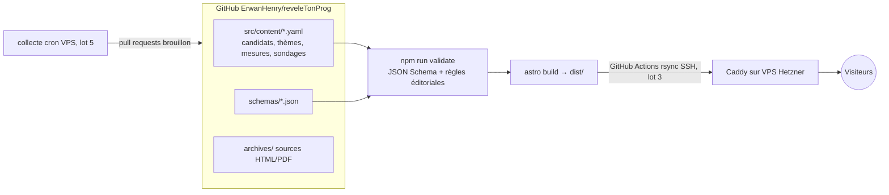

# Architecture — reveleTonProg

## Vue d'ensemble

## Composants

| Composant | Rôle | Tech | Hébergement |
|-----------|------|------|-------------|
| Contenu | Candidats, thèmes, mesures (4 rédactions), sondages | YAML | Dépôt Git |
| Validation | Schémas + mots interdits + longueurs + sources | Node, Ajv | CI GitHub Actions |
| Site | Pages thème / candidat, bascule de niveau | Astro statique | Caddy (VPS) |
| Collecte | Notices sondages, statuts candidats | Script Node cron | VPS (lot 5) |

## Décisions clés (ADR courts)

### ADR-001 : pas de base de données
- **Contexte** : VPS saturé (RAM 3,7 Go, disque 90 % en juillet 2026), besoin de traçabilité publique.
- **Décision** : tout le contenu vit en YAML dans Git ; le journal public découle de l'historique Git.
- **Conséquence** : pas de recherche serveur ; relecture = revue de pull request.

### ADR-002 : bascule de niveau sans JavaScript obligatoire
- **Contexte** : M1 doit fonctionner sans JS, la bascule doit se faire sans rechargement.
- **Décision** : les 4 rédactions sont dans le HTML ; la bascule est un groupe de boutons radio + CSS `:has()`. Un petit script mémorise le choix dans localStorage (amélioration progressive).
- **Conséquence** : poids de page légèrement supérieur (4 textes), reste très sous 500 Ko.

### ADR-003 : Astro content collections + JSON Schema en double garde
- **Contexte** : la spec impose JSON Schema validé en CI.
- **Décision** : `schemas/*.schema.json` est la source de vérité, validé par `scripts/validate.mjs` (Ajv) avant chaque build.
- **Conséquence** : le build échoue si une donnée est invalide.

## Dépendances externes critiques

- data.gouv.fr (statuts candidats) — risque si indispo : statuts non mis à jour, le site reste servi.
- Sites de campagne — risque : page modifiée ou supprimée → copie archivée dans `archives/`.
