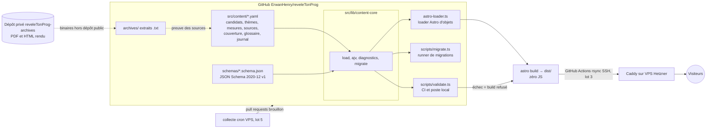

# Architecture — reveleTonProg

## Vue d'ensemble

Le module `content-core` est la seule implémentation de « lire un fichier YAML et le valider » : le validateur de la CI et le loader Astro l'appellent tous les deux, donc une donnée acceptée en CI est acceptée par le build, et inversement.

## Composants

| Composant | Rôle | Tech | Hébergement |
|-----------|------|------|-------------|
| Contenu | Candidats, thèmes, mesures (4 rédactions), sources, couverture, glossaire, journal, sondages | YAML | Dépôt Git |
| Schémas | Source de vérité de la forme des données | JSON Schema 2020-12 | Dépôt Git |
| content-core | Chargement YAML, validation Ajv, diagnostics fichier:ligne:colonne, migrations | TypeScript natif (Node 24) | Dépôt Git |
| Validation | `scripts/validate.ts` (CI et local), `scripts/migrate.ts` | Node, Ajv, yaml | CI GitHub Actions |
| Site | Pages thème / candidat, bascule de niveau | Astro statique | Caddy (VPS) |
| Archives | Extraits `.txt` des sources (public), binaires (privé) | Fichiers + dépôt privé | Dépôt Git / `reveleTonProg-archives` |
| Collecte | Notices sondages, statuts candidats | Script Node cron | VPS (lot 5) |

## Correspondance décisions D-n et ADR

| Décision | ADR | Sujet |
|----------|-----|-------|
| D-1 | ADR-004 | Vocabulaire des statuts |
| D-2 | ADR-005 | Périmètre d'équité |
| D-3 | ADR-006 | Presse comme source de statut |
| D-4 | ADR-007 | Mentions légales |
| D-5 | ADR-008 | Node 24 LTS |
| D-6 | ADR-009 | Poids de page |
| D-7 | ADR-010 | Collections supplémentaires |
| D-8 | ADR-011 | Stockage des archives |
| D-9 | ADR-012 | Licences |
| D-10 | ADR-013 | Lisibilité |
| D-11 | ADR-014 | Ordre aléatoire |
| D-12 | ADR-015 | Pas de photos |
| D-13 | ADR-016 | Historique Git et convention de contenu |

Les ADR techniques de la phase 1 (sans D-n) vont de l'ADR-017 à l'ADR-026.

## Décisions clés (ADR courts)

### ADR-001 : pas de base de données
- **Contexte** : VPS saturé (RAM 3,7 Go, disque 90 % en juillet 2026), besoin de traçabilité publique.
- **Décision** : tout le contenu vit en YAML dans Git ; le journal public découle de l'historique Git.
- **Conséquence** : pas de recherche serveur ; relecture = revue de pull request.

### ADR-002 : bascule de niveau sans JavaScript obligatoire
- **Contexte** : M1 doit fonctionner sans JS, la bascule doit se faire sans rechargement.
- **Décision** : les 4 rédactions sont dans le HTML ; la bascule est un groupe de boutons radio + CSS `:has()`. Un petit script mémorise le choix dans localStorage (amélioration progressive).
- **Conséquence** : poids de page légèrement supérieur (4 textes), reste très sous 500 Ko.

### ADR-003 : JSON Schema source de vérité, validé par content-core
- **Contexte** : la spec impose JSON Schema validé en CI, et la CI comme le build doivent appliquer exactement les mêmes règles.
- **Décision** : `schemas/*.schema.json` est la seule source de vérité. Ajv strict est appelé uniquement depuis `src/lib/content-core`, lui-même appelé par `scripts/validate.ts` (CI) et par le loader d'objets Astro, sans Zod par champ. Les scripts `.ts` s'exécutent nativement avec Node 24 (pas de tsx).
- **Conséquence** : le build échoue si une donnée est invalide, avec le même diagnostic qu'en CI. Les interfaces TypeScript du view-model sont écrites à la main.

### ADR-004 (D-1) : statuts = les 5 codes du jeu de données
- **Contexte** : la spec parle de « retiré », le jeu de données amont utilise `declare`, `primaire`, `pressenti`, `empeche`, `renonce`. Appeler « retiré » un candidat éliminé en primaire serait inexact.
- **Décision** : on stocke les 5 codes amont. `renonce` est affiché « Ne se présente pas » et exige un `motif` (`retrait`, `elimine_primaire`, `ralliement`, `non_candidat`). L'historique `statuts[]` est en ajout seul.
- **Conséquence** : l'import amont est sans perte et son diff reste trivial. Divergence assumée avec le mot « retiré » de la spec.

### ADR-005 (D-2) : l'équité couvre `declare` et `primaire`
- **Contexte** : il faut dire quels statuts doivent être couverts avant qu'un thème soit `publie`.
- **Décision** : `declare` + `primaire`, piloté par la configuration, pas en dur dans le code.
- **Conséquence** : les `pressenti` ont une page candidat mais ne bloquent pas une publication ; la règle est appliquée en phase 3.

### ADR-006 (D-3) : la presse peut sourcer un statut, jamais une mesure
- **Contexte** : sans la presse, la plupart des statuts n'auraient aucune source affichable aujourd'hui.
- **Décision** : `source.type: presse` est autorisé pour un statut uniquement, affiché sur le badge, remplacé dès qu'une source candidat, parti ou institution existe.
- **Conséquence** : une mesure ne peut jamais s'appuyer sur la presse ; la règle est vérifiée en phase 2.

### ADR-007 (D-4) : éditeur non professionnel
- **Contexte** : site politique pendant une campagne présidentielle, risque de harcèlement si l'adresse personnelle est publiée.
- **Décision** : mentions légales de l'éditeur non professionnel (LCEN art. 1-1 II) : nom donné volontairement, identité complète de l'hébergeur, alias de contact dédié, **aucune adresse personnelle**, procédure de droit de réponse.
- **Conséquence** : valable seulement sans promotion freelance, lien de don ou marque cliente sur le site. Contrôle juridique recommandé avant le lancement public (lot 3).

### ADR-008 (D-5) : Node 24 LTS
- **Contexte** : Node 20 est en fin de vie et ne peut pas exécuter Astro 7 ; Node 22 sort de support entre les deux tours.
- **Décision** : `.nvmrc` = 24, `engines >=24.12`, `engine-strict`. Exécution locale avec `fnm exec --using=24`. Exception au défaut Node 20 d'Erwan, propre à ce projet.
- **Conséquence** : le TypeScript natif de Node 24 évite tout transpileur ; la CI lit `.nvmrc` pour rester alignée.

### ADR-009 (D-6) : poids de page mesuré de deux façons
- **Contexte** : « moins de 500 Ko par page » ne dit pas si c'est compressé ou non.
- **Décision** : double garde en CI : HTML brut + ressources de même origine ≤ 500 Ko (audio exclu) **et** gzip ≤ 100 Ko, plus un test Slow-4G (150 ms de RTT, 1,6 Mb/s) avec `load` sous 1 s sur les pages les plus lourdes.
- **Conséquence** : si le brut approche du plafond, on découpe par sous-thème plutôt que de charger en JS ; la vérification arrive en phase 5.

### ADR-010 (D-7) : collections en plus des cinq de la spec
- **Contexte** : une source de programme appuie une trentaine de mesures ; l'équité et les définitions enfant doivent être vérifiables.
- **Décision** : ajout de `sources`, `couverture` et `glossaire` ; les partis sont des entrées de `glossaire` avec `type: parti` et une auto-description sourcée. `absences` = `couverture`.
- **Conséquence** : huit loaders partagent un même chargement ; pas de quatrième collection pour les partis.

### ADR-011 (D-8) : archives en extrait texte, binaires en dépôt privé
- **Contexte** : la spec prévoit une copie archivée dans le dépôt, ce qui expose à un risque de droit d'auteur et alourdit le dépôt et le disque du VPS.
- **Décision** : on commite `archives/<candidat>/<sha12>.txt` (extrait texte) avec sha256, date de capture et URL Wayback optionnelle ; PDF et HTML rendu vont dans le dépôt privé `reveleTonProg-archives` ; plafond de 5 Mo par fichier ; un contact de retrait sera publié.
- **Conséquence** : divergence avec la spec (« copie archivée dans le dépôt ») ; la preuve de ce qui était publié à la date de consultation reste établie.

### ADR-012 (D-9) : licences
- **Contexte** : le dépôt doit avoir des licences claires avant d'être public.
- **Décision** : code MIT, contenu éditorial Licence Ouverte 2.0 (cohérent avec les données amont), `archives/` et textes des candidats exclus (droits réservés à leurs auteurs, reproduits à titre de preuve et de citation). Un seul fichier `LICENSE`.
- **Conséquence** : les réutilisateurs savent ce qu'ils peuvent reprendre ; le code de 2027etmoi n'a aucune licence, la nôtre est un avantage de crédibilité.

### ADR-013 (D-10) : lisibilité, avertissement et erreur
- **Contexte** : un indice de lisibilité approximatif ne doit pas bloquer une publication à tort.
- **Décision** : l'alerte Kandel-Moles est un avertissement seulement ; une phrase « enfant » de plus de 15 mots est une erreur pour un contenu `publie`.
- **Conséquence** : la règle de longueur est ferme, l'indice reste informatif ; appliqué en phase 3.

### ADR-014 (D-11) : l'ordre aléatoire mémorise le mode, jamais la permutation
- **Contexte** : l'ordre des candidats doit être équitable, sans pister le visiteur.
- **Décision** : on mémorise `rtp:ordre = aleatoire`, jamais la permutation ; nouveau tirage à chaque chargement.
- **Conséquence** : c'est une personnalisation d'interface exemptée par la CNIL, cohérente avec la mémoire du niveau ; phase 6.

### ADR-015 (D-12) : aucune photo en v1.0
- **Contexte** : la disponibilité des photos varie selon les 59 personnes, ce qui serait une rupture visible de neutralité ; droits de la personnalité et attribution à gérer.
- **Décision** : aucune photo en v1.0, un même pictogramme neutre pour tous.
- **Conséquence** : pas de dette de licence d'image ; à rouvrir après la v1.0 si nécessaire.

### ADR-016 (D-13) : convention de contenu dès le premier commit
- **Contexte** : une publication de l'historique Git avant lancement n'est peu coûteuse que si la convention existe depuis le début.
- **Décision** : aucun commentaire informel de relecture dans les fichiers de contenu, gitleaks en CI sur tout l'historique ; la décision de squash est reportée au lot 3.
- **Conséquence** : l'historique reste publiable ; les remarques de relecture vivent dans les pull requests.

### ADR-017 : options de parsing YAML
- **Contexte** : le loader `file()` d'Astro lit les dates en `Date` et résout les fusions de clés ; la CI doit parser comme le build, avec les lignes.
- **Décision** : `parseDocument(text, { schema: 'core', uniqueKeys: true, merge: false, lineCounter })`, sans le tag `timestamp`, avec `toJS({ maxAliasCount: 0 })` (aucun alias) ; les avertissements comptent comme des erreurs.
- **Conséquence** : les dates sont des chaînes, `no` reste une chaîne, les clés dupliquées sont refusées ; le loader Astro `file()` n'est jamais utilisé.

### ADR-018 : Ajv 2020 strict avec `unevaluatedProperties: false`
- **Contexte** : une faute de frappe dans un champ ou dans un schéma ne doit pas passer silencieusement.
- **Décision** : `ajv/dist/2020.js` en mode strict, `allErrors`, `$id` en URN, `unevaluatedProperties: false` sur chaque objet, trois formats maison (`date`, `date-time`, `https-url`), pas d'`ajv-formats`.
- **Conséquence** : une propriété inconnue est un diagnostic ; une erreur de schéma lève dès le chargement.

### ADR-019 : loader Astro d'objets, sans schéma, mémo partagé
- **Contexte** : Astro prend des données pour des références de contenu si on lui donne un schéma, et ses erreurs sont opaques.
- **Décision** : un loader qui appelle content-core, enregistre des objets dans le store sans `schema`, avec un mémo partagé entre les huit loaders (un seul chargement par build).
- **Conséquence** : le build échoue avec les diagnostics de content-core ; pas de Zod par champ.

### ADR-020 : `compressHTML: true`
- **Contexte** : la valeur par défaut d'Astro 7 (`'jsx'`) colle les mots voisins en supprimant les espaces entre balises en ligne.
- **Décision** : `compressHTML: true`, vérifié par le test de squelette qui garde les espaces entre éléments en ligne.
- **Conséquence** : HTML lisible par les lecteurs d'écran et plus léger.

### ADR-021 : champs de relecture sur chaque entrée de `statuts[]` (hypothèse A1)
- **Contexte** : la règle « date partielle seulement en brouillon » a besoin d'un point d'accroche.
- **Décision** : `statut_relecture`, `relecteur` et `date_relecture` vivent sur chaque entrée de `statuts[]`, pas au niveau candidat.
- **Conséquence** : si la relecture doit être portée au niveau candidat, une migration de schéma sera nécessaire après le gel.

### ADR-022 : `relu` exige un relecteur et une date (hypothèse A2)
- **Contexte** : DATA-03 n'exige enfant et aîné que pour `publie`.
- **Décision** : `relu` exige aussi `relecteur` et `date_relecture`.
- **Conséquence** : un peu plus strict que la spec, facile à assouplir.

### ADR-023 : `archive.sha256` et `wayback_url` (hypothèse A3)
- **Contexte** : le service de capture Wayback peut échouer ou être bloqué par robots.txt.
- **Décision** : `archive.sha256` est le hash de l'extrait `.txt` commité ; `archive.binaire_sha256` est optionnel (binaire du dépôt privé) ; `archive.wayback_url` est optionnel dans le schéma v1. Règle phase 2 : `archive.wayback_url` obligatoire pour toute source citée par une mesure `statut_relecture: publie`.
- **Conséquence** : la règle est appliquée par le code de phase 2, sans montée de version du schéma.

### ADR-024 : `source.candidats[]` obligatoire, champs du journal (hypothèse A4)
- **Contexte** : les règles de la phase 2 doivent relier une source à son candidat (auteur, soutien) et vérifier `mesure.candidat ∈ source.candidats`.
- **Décision** : `source.candidats[]` est requis ; les entrées du journal pointent avec `collection_cible` et `id_cible` (jamais `collection`, mot réservé par Astro).
- **Conséquence** : le lien source-candidat est vérifiable ; les noms de champs du journal ne heurtent pas le store Astro.

### ADR-025 : racine de contenu par défaut = la fixture
- **Contexte** : le dépôt n'a aucun contenu réel avant la phase 3, mais `npm run validate && npm test && npm run build` doit fonctionner dès le clonage.
- **Décision** : `RTP_CONTENT_ROOT` vaut par défaut `tests/fixtures/corpus-valide` (corpus fictif) ; `RTP_CONTENT_ROOT=.` cible le vrai corpus, que la CI valide aussi.
- **Conséquence** : le défaut change en phase 3, lorsque le vrai corpus devient la racine.

### ADR-026 : gitleaks en binaire MIT avec somme de contrôle
- **Contexte** : `gitleaks-action` est sous licence propriétaire depuis la v2.
- **Décision** : le binaire gitleaks 8.30.1 est téléchargé en CI avec son sha256 épinglé, vérifié par `sha256sum -c` avant extraction, puis lance `gitleaks git` sur tout l'historique.
- **Conséquence** : Dependabot ne met pas ce pin à jour ; la revue mensuelle d'hygiène le fait (voir le runbook).

## Dépendances externes critiques

- data.gouv.fr (statuts candidats) — risque si indispo : statuts non mis à jour, le site reste servi.
- Sites de campagne — risque : page modifiée ou supprimée → extrait texte dans `archives/` (binaires dans le dépôt privé `reveleTonProg-archives`) et URL Wayback quand elle existe (`wayback_url`).
