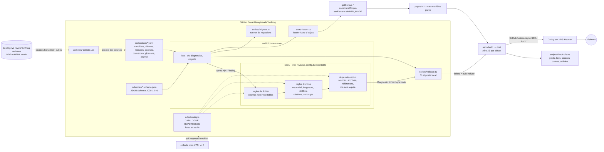

# Architecture — reveleTonProg

## Vue d'ensemble

Le module `content-core` est la seule implémentation de « lire un fichier YAML et le valider » : le validateur de la CI et le loader Astro l'appellent tous les deux, donc une donnée acceptée en CI est acceptée par le build, et inversement.

## Composants

| Composant | Rôle | Tech | Hébergement |
|-----------|------|------|-------------|
| Contenu | Candidats, thèmes, mesures (4 rédactions), sources, couverture, glossaire, journal, sondages | YAML | Dépôt Git |
| Schémas | Source de vérité de la forme des données | JSON Schema 2020-12 | Dépôt Git |
| content-core | Chargement YAML, validation Ajv, diagnostics fichier:ligne:colonne, migrations | TypeScript natif (Node 24) | Dépôt Git |
| Règles éditoriales | `content-core/rules/` : trois niveaux (fichier, entrée, corpus), codes stables, `config.ts` exportable pour la page Méthode | TypeScript natif | Dépôt Git |
| Validation | `scripts/validate.ts` (CI et local, `--mode`), `scripts/migrate.ts`, `scripts/ids.ts` (verrou des identifiants) | Node, Ajv, yaml | CI GitHub Actions |
| Pièges §12 | `tests/fixtures/pieges/<CODE>/attendu.json`, rejoués sur une copie de `corpus-valide` | `node:test` | CI GitHub Actions |
| Site | Pages thème / candidat, bascule de niveau | Astro statique | Caddy (VPS) |
| Archives | Extraits `.txt` des sources (public), binaires (privé) | Fichiers + dépôt privé | Dépôt Git / `reveleTonProg-archives` |
| Collecte | Notices sondages, statuts candidats | Script Node cron | VPS (lot 5) |

## Correspondance décisions D-n et ADR

| Décision | ADR | Sujet |
|----------|-----|-------|
| D-1 | ADR-004 | Vocabulaire des statuts |
| D-2 | ADR-005 | Périmètre d'équité |
| D-3 | ADR-006 | Presse comme source de statut |
| D-4 | ADR-007 | Mentions légales |
| D-5 | ADR-008 | Node 24 LTS |
| D-6 | ADR-009 | Poids de page |
| D-7 | ADR-010 | Collections supplémentaires |
| D-8 | ADR-011 | Stockage des archives |
| D-9 | ADR-012 | Licences |
| D-10 | ADR-013 | Lisibilité |
| D-11 | ADR-014 | Ordre aléatoire |
| D-12 | ADR-015 | Pas de photos |
| D-13 | ADR-016 | Historique Git et convention de contenu |

Les ADR techniques de la phase 1 (sans D-n) vont de l'ADR-017 à l'ADR-026 ; ceux de la phase 2 (règles éditoriales et pièges) de l'ADR-027 à l'ADR-033.

## Décisions clés (ADR courts)

### ADR-001 : pas de base de données
- **Contexte** : VPS saturé (RAM 3,7 Go, disque 90 % en juillet 2026), besoin de traçabilité publique.
- **Décision** : tout le contenu vit en YAML dans Git ; le journal public découle de l'historique Git.
- **Conséquence** : pas de recherche serveur ; relecture = revue de pull request.

### ADR-002 : bascule de niveau sans JavaScript obligatoire
- **Contexte** : M1 doit fonctionner sans JS, la bascule doit se faire sans rechargement.
- **Décision** : les 4 rédactions sont dans le HTML ; la bascule est un groupe de boutons radio + CSS `:has()`. Un petit script mémorise le choix dans localStorage (amélioration progressive).
- **Conséquence** : poids de page légèrement supérieur (4 textes), reste très sous 500 Ko.

### ADR-003 : JSON Schema source de vérité, validé par content-core
- **Contexte** : la spec impose JSON Schema validé en CI, et la CI comme le build doivent appliquer exactement les mêmes règles.
- **Décision** : `schemas/*.schema.json` est la seule source de vérité. Ajv strict est appelé uniquement depuis `src/lib/content-core`, lui-même appelé par `scripts/validate.ts` (CI) et par le loader d'objets Astro, sans Zod par champ. Les scripts `.ts` s'exécutent nativement avec Node 24 (pas de tsx).
- **Conséquence** : le build échoue si une donnée est invalide, avec le même diagnostic qu'en CI. Les interfaces TypeScript du view-model sont écrites à la main.

### ADR-004 (D-1) : statuts = les 5 codes du jeu de données
- **Contexte** : la spec parle de « retiré », le jeu de données amont utilise `declare`, `primaire`, `pressenti`, `empeche`, `renonce`. Appeler « retiré » un candidat éliminé en primaire serait inexact.
- **Décision** : on stocke les 5 codes amont. `renonce` est affiché « Ne se présente pas » et exige un `motif` (`retrait`, `elimine_primaire`, `ralliement`, `non_candidat`). L'historique `statuts[]` est en ajout seul.
- **Conséquence** : l'import amont est sans perte et son diff reste trivial. Divergence assumée avec le mot « retiré » de la spec.

### ADR-005 (D-2) : l'équité couvre `declare` et `primaire`
- **Contexte** : il faut dire quels statuts doivent être couverts avant qu'un thème soit `publie`.
- **Décision** : `declare` + `primaire`, piloté par la configuration, pas en dur dans le code.
- **Conséquence** : les `pressenti` ont une page candidat mais ne bloquent pas une publication ; la règle est appliquée en phase 3.

### ADR-006 (D-3) : la presse peut sourcer un statut, jamais une mesure
- **Contexte** : sans la presse, la plupart des statuts n'auraient aucune source affichable aujourd'hui.
- **Décision** : `source.type: presse` est autorisé pour un statut uniquement, affiché sur le badge, remplacé dès qu'une source candidat, parti ou institution existe.
- **Conséquence** : une mesure ne peut jamais s'appuyer sur la presse ; la règle est vérifiée en phase 2.

### ADR-007 (D-4) : éditeur non professionnel
- **Contexte** : site politique pendant une campagne présidentielle, risque de harcèlement si l'adresse personnelle est publiée.
- **Décision** : mentions légales de l'éditeur non professionnel (LCEN art. 1-1 II) : nom donné volontairement, identité complète de l'hébergeur, alias de contact dédié, **aucune adresse personnelle**, procédure de droit de réponse.
- **Conséquence** : valable seulement sans promotion freelance, lien de don ou marque cliente sur le site. Contrôle juridique recommandé avant le lancement public (lot 3).

### ADR-008 (D-5) : Node 24 LTS
- **Contexte** : Node 20 est en fin de vie et ne peut pas exécuter Astro 7 ; Node 22 sort de support entre les deux tours.
- **Décision** : `.nvmrc` = 24, `engines >=24.12`, `engine-strict`. Exécution locale avec `fnm exec --using=24`. Exception au défaut Node 20 d'Erwan, propre à ce projet.
- **Conséquence** : le TypeScript natif de Node 24 évite tout transpileur ; la CI lit `.nvmrc` pour rester alignée.

### ADR-009 (D-6) : poids de page mesuré de deux façons
- **Contexte** : « moins de 500 Ko par page » ne dit pas si c'est compressé ou non.
- **Décision** : double garde en CI : HTML brut + ressources de même origine ≤ 500 Ko (audio exclu) **et** gzip ≤ 100 Ko, plus un test Slow-4G (150 ms de RTT, 1,6 Mb/s) avec `load` sous 1 s sur les pages les plus lourdes.
- **Conséquence** : si le brut approche du plafond, on découpe par sous-thème plutôt que de charger en JS ; la vérification arrive en phase 5.

### ADR-010 (D-7) : collections en plus des cinq de la spec
- **Contexte** : une source de programme appuie une trentaine de mesures ; l'équité et les définitions enfant doivent être vérifiables.
- **Décision** : ajout de `sources`, `couverture` et `glossaire` ; les partis sont des entrées de `glossaire` avec `type: parti` et une auto-description sourcée. `absences` = `couverture`.
- **Conséquence** : huit loaders partagent un même chargement ; pas de quatrième collection pour les partis.

### ADR-011 (D-8) : archives en extrait texte, binaires en dépôt privé
- **Contexte** : la spec prévoit une copie archivée dans le dépôt, ce qui expose à un risque de droit d'auteur et alourdit le dépôt et le disque du VPS.
- **Décision** : on commite `archives/<candidat>/<sha12>.txt` (extrait texte) avec sha256, date de capture et URL Wayback optionnelle ; PDF et HTML rendu vont dans le dépôt privé `reveleTonProg-archives` ; plafond de 5 Mo par fichier ; un contact de retrait sera publié.
- **Conséquence** : divergence avec la spec (« copie archivée dans le dépôt ») ; la preuve de ce qui était publié à la date de consultation reste établie.

### ADR-012 (D-9) : licences
- **Contexte** : le dépôt doit avoir des licences claires avant d'être public.
- **Décision** : code MIT, contenu éditorial Licence Ouverte 2.0 (cohérent avec les données amont), `archives/` et textes des candidats exclus (droits réservés à leurs auteurs, reproduits à titre de preuve et de citation). Un seul fichier `LICENSE`.
- **Conséquence** : les réutilisateurs savent ce qu'ils peuvent reprendre ; le code de 2027etmoi n'a aucune licence, la nôtre est un avantage de crédibilité.

### ADR-013 (D-10) : lisibilité, avertissement et erreur
- **Contexte** : un indice de lisibilité approximatif ne doit pas bloquer une publication à tort.
- **Décision** : l'alerte Kandel-Moles est un avertissement seulement ; une phrase « enfant » de plus de 15 mots est une erreur pour un contenu `publie`.
- **Conséquence** : la règle de longueur est ferme, l'indice reste informatif ; appliqué en phase 3.

### ADR-014 (D-11) : l'ordre aléatoire mémorise le mode, jamais la permutation
- **Contexte** : l'ordre des candidats doit être équitable, sans pister le visiteur.
- **Décision** : on mémorise `rtp:ordre = aleatoire`, jamais la permutation ; nouveau tirage à chaque chargement.
- **Conséquence** : c'est une personnalisation d'interface exemptée par la CNIL, cohérente avec la mémoire du niveau ; phase 6.

### ADR-015 (D-12) : aucune photo en v1.0
- **Contexte** : la disponibilité des photos varie selon les 59 personnes, ce qui serait une rupture visible de neutralité ; droits de la personnalité et attribution à gérer.
- **Décision** : aucune photo en v1.0, un même pictogramme neutre pour tous.
- **Conséquence** : pas de dette de licence d'image ; à rouvrir après la v1.0 si nécessaire.

### ADR-016 (D-13) : convention de contenu dès le premier commit
- **Contexte** : une publication de l'historique Git avant lancement n'est peu coûteuse que si la convention existe depuis le début.
- **Décision** : aucun commentaire informel de relecture dans les fichiers de contenu, gitleaks en CI sur tout l'historique ; la décision de squash est reportée au lot 3.
- **Conséquence** : l'historique reste publiable ; les remarques de relecture vivent dans les pull requests.

### ADR-017 : options de parsing YAML
- **Contexte** : le loader `file()` d'Astro lit les dates en `Date` et résout les fusions de clés ; la CI doit parser comme le build, avec les lignes.
- **Décision** : `parseDocument(text, { schema: 'core', uniqueKeys: true, merge: false, lineCounter })`, sans le tag `timestamp`, avec `toJS({ maxAliasCount: 0 })` (aucun alias) ; les avertissements comptent comme des erreurs.
- **Conséquence** : les dates sont des chaînes, `no` reste une chaîne, les clés dupliquées sont refusées ; le loader Astro `file()` n'est jamais utilisé.

### ADR-018 : Ajv 2020 strict avec `unevaluatedProperties: false`
- **Contexte** : une faute de frappe dans un champ ou dans un schéma ne doit pas passer silencieusement.
- **Décision** : `ajv/dist/2020.js` en mode strict, `allErrors`, `$id` en URN, `unevaluatedProperties: false` sur chaque objet, trois formats maison (`date`, `date-time`, `https-url`), pas d'`ajv-formats`.
- **Conséquence** : une propriété inconnue est un diagnostic ; une erreur de schéma lève dès le chargement.

### ADR-019 : loader Astro d'objets, sans schéma, mémo partagé
- **Contexte** : Astro prend des données pour des références de contenu si on lui donne un schéma, et ses erreurs sont opaques.
- **Décision** : un loader qui appelle content-core, enregistre des objets dans le store sans `schema`, avec un mémo partagé entre les huit loaders (un seul chargement par build).
- **Conséquence** : le build échoue avec les diagnostics de content-core ; pas de Zod par champ.

### ADR-020 : `compressHTML: true`
- **Contexte** : la valeur par défaut d'Astro 7 (`'jsx'`) colle les mots voisins en supprimant les espaces entre balises en ligne.
- **Décision** : `compressHTML: true`, vérifié par le test de squelette qui garde les espaces entre éléments en ligne.
- **Conséquence** : HTML lisible par les lecteurs d'écran et plus léger.

### ADR-021 : champs de relecture sur chaque entrée de `statuts[]` (hypothèse A1)
- **Contexte** : la règle « date partielle seulement en brouillon » a besoin d'un point d'accroche.
- **Décision** : `statut_relecture`, `relecteur` et `date_relecture` vivent sur chaque entrée de `statuts[]`, pas au niveau candidat.
- **Conséquence** : si la relecture doit être portée au niveau candidat, une migration de schéma sera nécessaire après le gel.

### ADR-022 : `relu` exige un relecteur et une date (hypothèse A2)
- **Contexte** : DATA-03 n'exige enfant et aîné que pour `publie`.
- **Décision** : `relu` exige aussi `relecteur` et `date_relecture`.
- **Conséquence** : un peu plus strict que la spec, facile à assouplir.

### ADR-023 : `archive.sha256` et `wayback_url` (hypothèse A3)
- **Contexte** : le service de capture Wayback peut échouer ou être bloqué par robots.txt.
- **Décision** : `archive.sha256` est le hash de l'extrait `.txt` commité ; `archive.binaire_sha256` est optionnel (binaire du dépôt privé) ; `archive.wayback_url` est optionnel dans le schéma v1. Règle phase 2 : `archive.wayback_url` obligatoire pour toute source citée par une mesure `statut_relecture: publie`.
- **Conséquence** : la règle est appliquée par le code de phase 2, sans montée de version du schéma.

### ADR-024 : `source.candidats[]` obligatoire, champs du journal (hypothèse A4)
- **Contexte** : les règles de la phase 2 doivent relier une source à son candidat (auteur, soutien) et vérifier `mesure.candidat ∈ source.candidats`.
- **Décision** : `source.candidats[]` est requis ; les entrées du journal pointent avec `collection_cible` et `id_cible` (jamais `collection`, mot réservé par Astro).
- **Conséquence** : le lien source-candidat est vérifiable ; les noms de champs du journal ne heurtent pas le store Astro.

### ADR-025 : racine de contenu par défaut = la fixture
- **Contexte** : le dépôt n'a aucun contenu réel avant la phase 3, mais `npm run validate && npm test && npm run build` doit fonctionner dès le clonage.
- **Décision** : `RTP_CONTENT_ROOT` vaut par défaut `tests/fixtures/corpus-valide` (corpus fictif) ; `RTP_CONTENT_ROOT=.` cible le vrai corpus, que la CI valide aussi.
- **Conséquence** : le défaut change en phase 3, lorsque le vrai corpus devient la racine.

### ADR-026 : gitleaks en binaire MIT avec somme de contrôle
- **Contexte** : `gitleaks-action` est sous licence propriétaire depuis la v2.
- **Décision** : le binaire gitleaks 8.30.1 est téléchargé en CI avec son sha256 épinglé, vérifié par `sha256sum -c` avant extraction, puis lance `gitleaks git` sur tout l'historique.
- **Conséquence** : Dependabot ne met pas ce pin à jour ; la revue mensuelle d'hygiène le fait (voir le runbook).

### ADR-027 : trois niveaux de règles, une seule voie vers le diagnostic
- **Contexte** : les règles éditoriales ne se réduisent pas à la forme d'un fichier : certaines lisent un fichier, d'autres une entrée validée, d'autres tout le corpus (références, équité, `ids.lock`).
- **Décision** : `loadAll` appelle, après Ajv, des règles de **fichier** (document YAML, même invalide), d'**entrée** (une entrée valide) et de **corpus** (une fois, sur l'ensemble). Une règle renvoie des `Finding` ; le moteur seul les convertit en `Diagnostic` (position par pointeur JSON ou ligne explicite). Une règle qui plante donne `REGLE_ECHEC` et la validation échoue : jamais de passage en silence. Tous les seuils, listes et le catalogue des codes vivent dans `rules/config.ts`, module pur exportable pour la page Méthode.
- **Conséquence** : CI et loader Astro appliquent les mêmes règles ; une règle ajoutée ne touche ni le schéma ni le CLI ; chaque code est catalogué et testé.

### ADR-028 : mode de validation fail-closed, seule l'équité en dépend
- **Contexte** : rédiger un thème candidat par candidat laisse des trous d'équité transitoires, qui ne doivent pas bloquer le travail local mais jamais la publication.
- **Décision** : `--mode preview|production`, puis `RTP_MODE`, puis `production` par défaut ; une valeur inconnue est une erreur d'usage (code 2). Seules `EQUITE_CANDIDAT_MANQUANT` et `EQUITE_COUVERTURE_INCOHERENTE` passent en avertissement en preview. La CI passe `--mode production` à chaque étape `validate`, vérifié par `tests/repo/ci.test.ts`.
- **Conséquence** : un oubli de réglage ne peut qu'aggraver la sévérité ; le build Astro et le CLI résolvent le mode par la même fonction.

### ADR-029 : pièges de données en surcouche, comparaison exacte
- **Contexte** : le cahier des charges §12 exige sept données piégées qui doivent échouer ; une fixture fautive par piège dupliquerait le corpus et dériverait.
- **Décision** : un piège est un `attendu.json` (patches `remplacer` appliqués une seule fois, `supprimer`, fichiers de surcouche) rejoué sur une copie temporaire de `corpus-valide`, avec égalité d'ensembles exacte sur (code, sévérité, fichier, pointeur) et ligne optionnelle. Un test de couverture échoue si un piège §12 manque, si un code n'est jamais testé ou si `config.ts` cesse d'être exportable.
- **Conséquence** : un piège qui passe, qui disparaît ou qui produit un diagnostic de trop casse `npm test` ; des variantes `--…-ok` figent les faux positifs corrigés.

### ADR-030 : syllabes comptées par heuristique calibrée sur Lexique 3.83, sans textstat
- **Contexte** : l'indice Kandel-Moles de la rédaction enfant exige un décompte de syllabes français ; les paquets npm de lisibilité sont anglophones, textstat est en Python.
- **Décision** : une heuristique maison d'une trentaine de lignes, dont le résultat est figé par une table d'environ 170 mots tirés de Lexique 3.83 (CC BY-SA 4.0, crédité dans le test) et par des exceptions connues documentées. Aucune dépendance ajoutée. L'indice reste un avertissement (seuil 80), la longueur de phrase (15 mots) est l'erreur.
- **Conséquence** : calibrage reproductible et auditable ; si l'écart devient trop grand, `hyphen` pourra le remplacer avec sa propre justification (DIFF-01).

### ADR-031 : `ids.lock` en ajout seul, contrôlé par le script et par la CI
- **Contexte** : une URL de candidat est permanente ; renommer ou supprimer un identifiant casse les liens, et supprimer la ligne **avec** le fichier du candidat échappe à une vérification locale.
- **Décision** : `<racine>/ids.lock` liste les identifiants triés, un par ligne ; `npm run ids -- --write` ne fait qu'ajouter et refuse toute disparition ; `--check` compare le verrou aux candidats ; en CI, une étape dédiée lance `npm run ids -- --check --base <ids.lock du commit de base>` (branche cible d'une pull request, ou commit précédent d'un push) et échoue avec `ID_VERROUILLE_DISPARU` pour toute ligne retirée.
- **Conséquence** : la suppression silencieuse d'un candidat verrouillé est bloquée avant fusion ; l'importeur de la phase 3 réutilise la même routine d'ajout.

### ADR-032 : chaque chiffre et chaque citation remontent à l'archive, mot pour mot
- **Contexte** : une rédaction simplifiée peut inventer un chiffre ou déguiser une phrase en citation entre « », et un `texte_source` ou un `chiffrage` peut ne pas être dans la source réellement archivée.
- **Décision** : tout nombre de résumé, enfant et aîné doit figurer dans `texte_source` ou `chiffrage.texte` (comparaison décimale canonique, sans flottant ; nombres en lettres en avertissement) ; chaque `« … »` d'un champ éditorial doit être dans `texte_source` ; `texte_source` et `chiffrage.texte` doivent être dans l'extrait archivé (casse et ponctuation ignorées, accents significatifs). Le chiffrage n'est cru qu'une fois lui-même retrouvé dans l'archive. Le filtre de mots interdits n'exempte un passage entre « » que parce que ce passage est vérifié.
- **Conséquence** : aucun chiffre ni citation ne peut entrer sans source primaire archivée ; une archive déjà signalée cassée n'ajoute pas d'erreurs en cascade.

### ADR-033 : hypothèses P2-A1 à P2-A12, choix par défaut fail-closed
- **Contexte** : douze points n'étaient pas tranchés par les décisions de l'éditeur ; chacun a reçu un défaut, consigné dans `HYPOTHESES` (`rules/config.ts`) pour que la page Méthode et la relecture puissent les citer.
- **Décision** : les défauts et leur risque si le choix est mauvais :
  - **A1** : environ 170 couples mot/syllabes de Lexique 3.83 figés dans un test, avec crédit. Risque faible (des faits, un extrait minime) ; sinon régénérer la table à la main.
  - **A2** : syntaxe `[[affiché]]` ou `[[affiché|id]]` pour le glossaire, remplacée par son texte avant tout décompte. Risque moyen : la phase 4 peut en choisir une autre ; seuls `references.ts` et un pré-traitement changent.
  - **A3** : `relu` traité comme `publie` pour `PHRASE_ENFANT_LONGUE` (erreur) ; seul `brouillon` rétrograde en avertissement. Risque faible.
  - **A4** : `LONGUEUR_HORS_BORNES` est une erreur quel que soit le statut. Risque moyen : les brouillons collectés par agents en phase 3 doivent déjà respecter les bornes.
  - **A5** : un candidat absent de `ids.lock` est une erreur (`ID_NON_VERROUILLE`). Risque faible : un seul geste, `npm run ids -- --write`.
  - **A6** : le périmètre d'équité se lit sur le statut le plus récent par date de `statuts[]` (à date égale, le dernier de la liste), quel que soit son statut de relecture. Risque moyen : un statut `declare` en brouillon bloque un thème publié tant que le candidat n'est pas couvert.
  - **A7** : un duel au premier tour = exactement deux scores dont la somme atteint au moins 99 ou dont « autres » est sous 5 %, ou un nom évoquant le second tour (deuxième tour, ballottage, finale, T2) ; seuils et motif en configuration. Risque moyen (heuristique) : deux scores avec 5 % ou plus d'« autres » restent admis au premier tour, car le corpus fictif n'a que deux candidats. Verrouillé par un piège et des variantes négatives.
  - **A8** : une fenêtre de blocage inclut son début et exclut sa fin (20h00 pile autorisé). Risque faible : une seconde d'ambiguïté.
  - **A9** : GitHub limite les annotations à 10 erreurs et 10 avertissements par étape ; le journal texte reste complet. Risque faible : n'affecte que l'affichage.
  - **A10** : les bornes 00h00 et 20h00 viennent du cahier des charges (§6), pas du texte de l'article 11 de la loi 77-808 ; le vote du samedi outre-mer n'est pas couvert par ces fenêtres. Risque faible : le cahier des charges fait foi. **Dette différée (relecture de code, WR-10)** : la règle ne juge que `date_publication`, pas l'instant où le site est construit ou servi. Un sondage publié le 10 avril et encore affiché le 17 avril serait conforme pour le validateur mais pas pour l'esprit de la loi. À traiter à l'affichage des sondages (lot 4) : masquer les sondages, ou faire échouer le build de production, quand l'horloge de build tombe dans une fenêtre (horloge injectable pour les tests).
  - **A11** : « mot pour mot » = casse et ponctuation ignorées, accents significatifs. Risque moyen : une lecture plus stricte rejetterait plus de citations ; il suffit de resserrer `tokens()`.
  - **A12** : seuil Kandel-Moles à 80, avertissement seulement, même si la fixture saine a demandé une retouche. Risque faible : la calibration est renvoyée à DIFF-01.
- **Conséquence** : tout changement de défaut passe par `HYPOTHESES` et `rules/config.ts`, relu en pull request, avec un piège qui fige le nouveau comportement.

### ADR-034 : cartes à structure fixe, pas à hauteur fixe (règle des 160 %)
- **Statut** : décidé le 2026-11-03 par l'orchestrateur au nom d'Erwan, à sa demande de trancher en autonomie (ce n'était pas une question de point de contrôle).
- **Contexte** : l'exigence M1-08 parle de cartes « de taille fixe » par cellule thème × candidat.
- **Décision** : « taille fixe » veut dire **structure fixe** : exactement une mesure plus la ligne « N autres mesures », les mêmes zones dans le même ordre, des largeurs égales, des rangées alignées, avec une **hauteur variable**. Une hauteur fixe en pixels couperait ou ferait déborder le texte à 160 % de zoom du texte et en « Gros caractères » (WCAG 1.4.4 et 1.4.10). La règle d'une seule mesure par cellule garde aussi les pages thème sous le budget de 100 Ko gzip.
- **Conséquence** : aucun `height` ni `max-height` en px, aucune troncature sur les cartes, ce que `tests/ui/styles.test.ts` impose.

### ADR-035 : pages M1 en vue-modèle pure, `getCorpus` seul lecteur de `RTP_MODE`, production en échec fermé
- **Contexte** : les pages doivent afficher les mêmes données en preview (brouillons visibles, pastillées) et en production (publié seulement) sans qu'un composant décide seul de ce qui est visible.
- **Décision** : les composants ne reçoivent que des vues-modèles pures calculées par `src/lib/corpus` ; `getCorpus` est le seul code qui lit `RTP_MODE`. Sans mode demandé, c'est la production, et un corpus invalide fait échouer le build.
- **Conséquence** : un brouillon ne peut pas fuiter en production par oubli dans une page ; ajouter une page ne touche pas à la logique de visibilité.

### ADR-036 : statuts, périmètre et copie archivée : dernier statut relu, cases pour déclaré ou primaire, badges de prévisualisation, Wayback et extrait GitHub
- **Contexte** : hypothèses A1 à A4 de la recherche de la phase 4, adoptées par défaut en attendant la relecture d'Erwan.
- **Décision** : A1, le statut affiché en production est celui de la dernière entrée relue, sinon « Statut en cours de vérification » ; A2, des cartes seulement pour les statuts `declare` et `primaire`, `renonce` dans la section repliée, les autres comptés sur une seule ligne ; A3, textes des badges « brouillon, non relu » et « relu, pas encore publié » ; A4, copie archivée = lien Wayback plus lien vers l'extrait (sha256) sur GitHub, en 404 tant que le dépôt n'est pas public.
- **Conséquence** : chaque défaut est modifiable à un seul endroit ; la liste est reprise dans le SUMMARY 04-09 pour la relecture d'Erwan.

### ADR-037 : pages compatibles CSP, CSS et scripts externes hachés, aucun code en ligne
- **Contexte** : vie privée et sécurité imposent zéro script externe ; une politique CSP stricte du lot 3 ne doit pas casser les pages.
- **Décision** : aucun `<script>` ni `style=` en ligne, CSS et scripts servis depuis `/_astro/` avec un nom haché, seules clés `localStorage` : `rtp:niveau` et `rtp:ordre`. `check-dist` rejette `SCRIPT_EN_LIGNE`, `STYLE_EN_LIGNE`, `SCRIPT_DATA_URI` et `RESSOURCE_TIERCE`.
- **Conséquence** : la CSP du lot 3 peut interdire `unsafe-inline` ; un script de plus de 2 Ko échoue au contrôle.

### ADR-038 : contrôle post-build `check-dist` sans dépendance, gzip d'abord
- **Contexte** : le budget de poids et les règles de page doivent échouer en CI, sur ce qui est réellement servi.
- **Décision** : `scripts/check-dist.ts` lit `dist/` avec un petit analyseur HTML maison (`scripts/lib/html.ts`) et `node:zlib`. La limite de 100 Ko gzip par page (HTML plus CSS et JS liés) mord avant celle de 500 Ko bruts. La CI l'exécute juste après `npm run build`, en production.
- **Conséquence** : aucune dépendance ajoutée ; un brouillon, un tiers, une source sans date ou une cellule incohérente fait échouer le job.

### ADR-039 : un seul fichier de test lance `astro build`, tranches en modules `.cas.ts`, `corpus-m1` en surcouche
- **Contexte** : un build coûte plusieurs secondes ; chaque tranche voulait le sien.
- **Décision** : `tests/dist/site.test.ts` est le seul à lancer `astro build`, mémorise chaque build par clé et charge tous les `tests/dist/cas/*.cas.ts`. Le corpus fictif `corpus-m1` est matérialisé en surcouche de `corpus-valide` dans un dossier temporaire.
- **Conséquence** : deux builds (production et preview) servent toutes les tranches ; ajouter des assertions ne relance pas de build.

### ADR-040 : niveaux de lecture par boutons radio et `:has()`, `autocomplete="off"`, ordre aléatoire à la demande
- **Contexte** : le choix du niveau doit marcher sans JavaScript, et l'ordre des candidats ne doit jamais suivre les sondages.
- **Décision** : le niveau est un groupe de boutons radio dont `:has(:checked)` pilote l'affichage en CSS pur, avec `autocomplete="off"` pour que le navigateur ne restaure pas un état contradictoire ; un petit script mémorise `rtp:niveau`. L'ordre par défaut est alphabétique ; l'ordre aléatoire (Fisher-Yates) n'existe que sur demande, avec JavaScript, mémorisé dans `rtp:ordre`.
- **Conséquence** : sans JavaScript, tout fonctionne sauf la mémoire du niveau et l'ordre aléatoire, annoncé comme tel.

## Dépendances externes critiques

- data.gouv.fr (statuts candidats) — risque si indispo : statuts non mis à jour, le site reste servi.
- Sites de campagne — risque : page modifiée ou supprimée → extrait texte dans `archives/` (binaires dans le dépôt privé `reveleTonProg-archives`) et URL Wayback quand elle existe (`wayback_url`).
